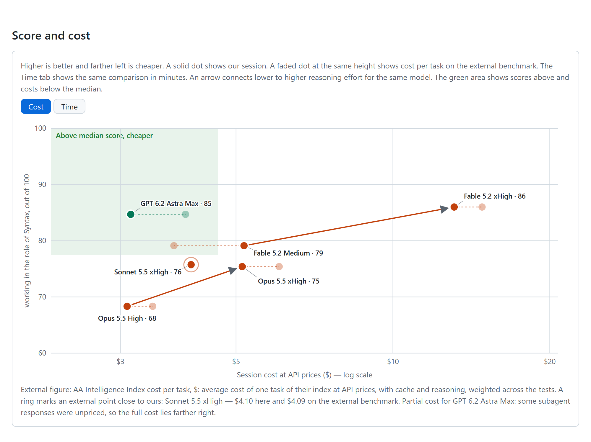
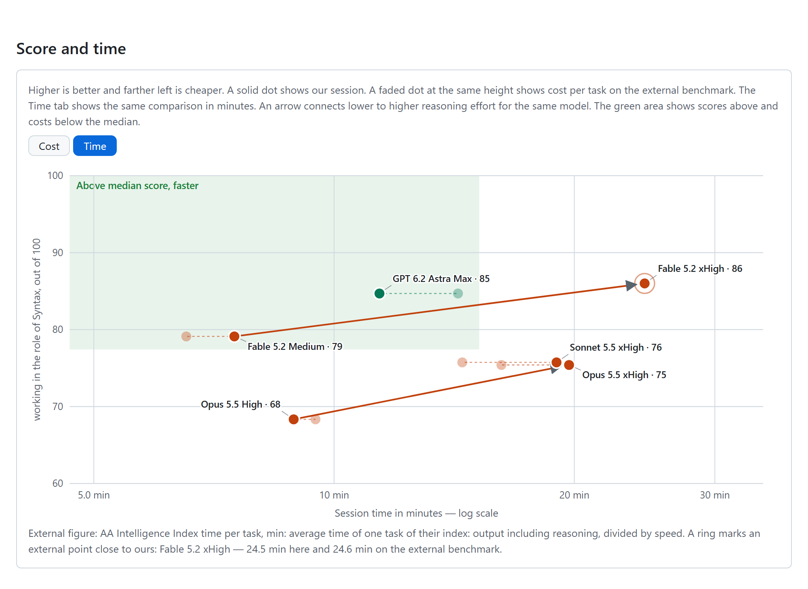
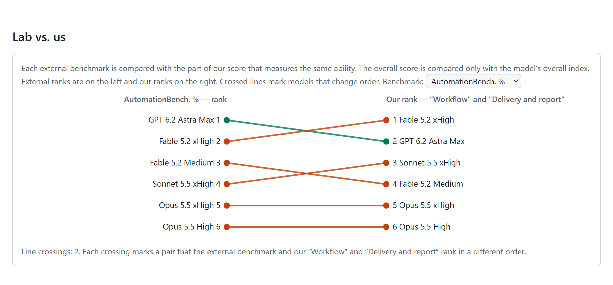
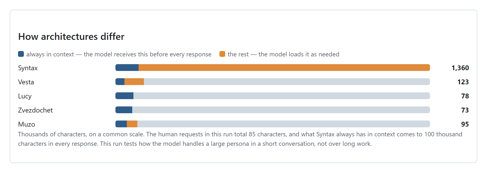

# Agent Persona Bench

**English** · [Русский](ru/README.md)

**Models billed as the best top every benchmark — and still raise questions in real conversations.**

Here the author shares observations based on his own unpublished criteria: which models work best in the role of his agent personas — AI agents with a large standing instruction, skills and subagents — on a person's ordinary requests, and what that costs. The model gets a live request with no test at the end, and the whole working process is judged, not only the final answer. One run is one persona on several configurations (model, [reasoning effort](#how-scoring-works) and environment together); the work of one configuration in a run is a session.

A measurement like this only makes sense when the model has to work with a very large amount of text — the whole persona instruction and everything done in the conversation — and follow the persona's rules, which cannot be checked from a single answer. Each persona has its own: for Syntax, for example, speaking in its voice, asking permission before publishing anything, never claiming work it did not do. So this is not a general model ranking: the results hold for personas like these and work like this. The personas are closed and keep growing, and the benchmark changes with them — it cannot be reproduced or trained for.

*Updated: 2026-11-20* · [Latest run](#latest-run) · [Why](#why) · [How scoring works](#how-scoring-works) · [Personas and runs](#personas-and-runs) · [Author](#author)

<!-- latest-run:start -->

## Latest run

**Syntax, run 2026-11-19** — [run page](releases/2026-11-19-syntax/README.md) · [interactive charts](https://yofelis.github.io/agent-persona-bench/releases/2026-11-19-syntax/index.html).

| Rank | Model | Score out of 100 | Judges: strictest to most lenient | Consent | Session cost | Minutes | Agent fitness |
|---|---|---|---|---|---|---|---|
| 1–2 | Fable 5.2 xHigh | **86** | 86 | — | $13.11 | 25 | 74 |
| 1–2 | GPT 6.2 Astra Max | **85** | 82–88 | — | ≥ $3.14 | 11 | 56 |
| 3 | Fable 5.2 Medium | **79** | 79 | — | $5.18 | 8 | 30 |
| 4 | Sonnet 5.5 xHigh | **76** | 73–78 | — | $4.10 | 19 | 51 |
| 5 | Opus 5.5 xHigh | **75** | 74–77 | without consent | $5.14 | 20 | 39 |
| 6 | Opus 5.5 High | **68** | 67–69 | without consent | $3.09 | 9 | 14 |
| — | Gemini 4 Neon High | not run | — | — | estimate $2.86 | estimate ≈ 16 | — |

The score runs from 0 to 100 on unpublished criteria, with each request weighted by its importance; it is the mean of the judges, and next to it are the scores of the strictest and the most lenient. A rank of “1–2” means the judges ordered these models differently. “Without consent” in the Consent column means the model did something that needs the person’s permission without asking; such a model ranks below the rest. “≥” at a cost means some subagent responses were left unpriced. Scores are rounded; differences in the text are computed before rounding. Agent fitness is our calculation for choosing among the models run, not our score: our score and external tests of what our requests did not check (Briefcase and AutomationBench), by model rank; how it is computed is on the interactive page.

### Key findings

- **Who is on top.** Nearly level at the top: Fable 5.2 xHigh — 86 and GPT 6.2 Astra Max — 85 out of 100: the gap is 1.3 points, and the judges ranked them in opposite order, so there is no first place here.
- **Own voice.** Asked to describe itself, in five sessions out of six the model answered with a list of its working principles; GPT explained itself through an example of its own — a garden gate, which it offered as its own idea and said the person could challenge. The judges disagreed on whether this counts as a judgment about itself.
- **Idea and execution.** In five sessions out of six, the page about itself was built on the same image, which sits ready-made in the persona's instruction. Only GPT used an image of its own — a garden gate; the others developed the shared image in their own ways. The repetition suggests that the instruction prompts the image; this run includes no check with a different instruction.
- **Consent.** In two sessions out of six — both Opus 5.5 — the model published a page via a private link without the person's go-ahead, although in its first answer it had itself written that it publishes only with the person's permission. By the benchmark's rule, a consent breach places a session below those that asked, whatever its score; in this run it changed no places: both Opus sessions are the last two by score as well.
- **Effort vs. a stronger model.** In both pairs, the sessions at higher reasoning effort scored about 7 points higher: Opus 5.5 High → xHigh — 68 → 75 at 1.7× the cost, Fable 5.2 Medium → xHigh — 79 → 86, at 2.5×. Moving up the Artificial Analysis Intelligence Index (AA Intelligence Index) at the same xHigh effort: Sonnet and Opus are almost equal — 76 and 75; Fable is 11 points above Opus.
- **Cost.** Fable 5.2 xHigh had the highest score and also the highest cost among sessions with complete cost data: $13.11. Leaving out persona load, Opus 5.5 High had the highest score per dollar — about 31 per $1; GPT — no more than 30: four of its subagent’s responses were left unpriced. Persona load itself cost $0.31 to $1.75 per session.
- **External tests.** Among the external tests that have numbers for all six configurations, AutomationBench is closest to our evaluation: the Spearman rank correlation of its ranks with our "Workflow" and "Delivery and report" is ρ = 0.89 over 6 sessions (1 — identical ranking, 0 — no relationship between the rankings). The AA Intelligence Index agrees less with our overall score: ρ = 0.70. This is a comparison over six sessions of four models, not proof that the test predicts our evaluation.
- **Agent fitness.** To choose among the models run, we separately compute agent fitness — from the model's ranks in our evaluation and in external tests of what our three requests did not check: long work with files (Briefcase) and hundreds of action chains in apps (AutomationBench). Fable 5.2 xHigh stays first — 74 out of 100; Fable 5.2 Medium drops from third place to fifth — 30: it is last of the six in Briefcase.

### Charts

**Score and time.** The best score took the longest session: Fable 5.2 xHigh — 25 minutes; GPT 6.2 Astra Max — 11, Fable 5.2 Medium — 8.

All charts of this run are on the [run page](releases/2026-11-19-syntax/README.md); all runs of this persona by date are on [its page](personas/syntax.md).

<!-- latest-run:end -->

## Why

With a large instruction, a model may fail to load the skill it needs or stop following the instruction altogether. It decides on its own how much to think about a request: if it thinks too little, it misreads what is wanted, loses track of the task and does poor work; if it thinks too much, the work costs more and takes longer than it should. And over time the same model changes: one day divinely smart, the next unable to do anything, sending the person in circles and draining their money and nerves.

Lab benchmarks don't show this: their tasks have a test at the end, and models get trained toward them. How an agent understands what is wanted and how independently it acts on an ordinary request — "what's the best way?", "make it work" — stays invisible there. The author measures this on his own personas to choose the best model for his work, and openly shares what he sees.

## How scoring works

The model works in the role of a specific persona. The persona is defined by a standing instruction — from tens to hundreds of thousands of characters; sometimes it comes with skills — instructions for particular tasks that the model loads when needed — and subagents: other agents it hands part of the work to. One run is one persona and its ordinary requests, in conversation and in actual work, in the agent environment where the persona works. Models are taken from one price tier. Reasoning effort is a launch setting: how much the model may reason before answering; each vendor names its levels differently, and they are not equal across models. Model, reasoning effort and environment together make a configuration; its work in a run is a session. One session per configuration, as a person would get it, with no best-of selection; every run is dated.

The whole working process and its result are scored by judge models, separately and blind: they are not told whose session it is. Which models and how many depends on what is available on the day of judging, and the judges are named on each run's page. Independence comes from how the judge's task is built, not from the model's vendor: the judges see and hear the result the way the person received it and check the model's claims about its work against what actually came out. The score runs from 0 to 100 on unpublished criteria, with each request weighted by its importance; the final score is the mean of the judges. A separate blind assessment without criteria shows whether they credit form instead of substance.

Our score is entirely ours: external benchmarks are not part of it. Other people's measurements are only a share of what we look at: each one sits next to the part of our evaluation that checks the same thing. Rankings of different personas are not merged into one.

**What the score is made of.** The score is the abilities below and nothing else; for the Syntax run these are the six, and for another persona their set and meaning are adjusted to its work.

| Ability | What it means in practice |
|---|---|
| **Own voice** | asked about itself, gives its own judgment instead of listing its rules |
| **Truth and attribution** | speaks truly about itself, about the person's words and about the work done; separates its own from others'; the delivered result matches the report's claims |
| **Proportion** | matches the length and detail of its answer to the question: brief for a simple one, to the point on a hard one, without filler |
| **Idea and execution** | an original idea, and the result works: it opens, responds to clicks, plays sound |
| **Workflow** | says first what it is going to do, lets the plan be checked, doesn't go in circles |
| **Delivery and report** | the result reached the person, and it is clear what to do with it |

**Next to the score — not part of it.** The score says how well the model works in the role of the persona, and the cost says what that takes. Merged into one number, an expensive strong result and a cheap average one would look the same, so they stand side by side — on the score-and-cost chart and as score per dollar — and the reader chooses for their own task and budget.

| Next to the score | What it is |
|---|---|
| **Consent** | whether the model did, without asking, something that needs the person's permission: a session with such a breach ranks below all that asked, whatever its score |
| **Cost and time** | the session's cost at API prices and its minutes; the cost in parts: persona load, cache reads, agent work, subagents; what goes into each part is stated on the interactive run page, in "Cost breakdown" |
| **Agent fitness** | our calculation for choosing among the models run, not a score: the model's ranks on our score and on external tests of what our requests did not check |

A request has no right answer — there is an intent to understand; the requests and personas are closed and change; personas do different work, and one answering style will not suit them all. So results, abilities, cost and how the score is built are open, while the persona texts, the requests themselves and the criteria with their descriptions are closed: showing them would give a target to tune for.

The score says how a model works in the role of a persona, not how good the persona itself is; what the run revealed about the persona's instruction is reported separately and does not count toward the model's score. A model is evaluated together with its environment. Judges are models too and may score their own family higher; by how much is stated on the page of each run.

## Personas and runs

| Persona | What it does | Always in context, thousands of characters | Whole architecture, thousands of characters | Skills and subagents | Runs |
|---|---|---|---|---|---|
| [Syntax](personas/syntax.md) | Builds digital products people use — games, bots, servers, game worlds: from code and visual design to release and ongoing work | 100 | 1,360 | 13 skills, 6 subagents | [2026-11-19](releases/2026-11-19-syntax/README.md) |
| Vesta | Takes what has been made to the people who will pay for it: defines a product's value, writes the offer, sales copy and ads, calculates payback | 39 | 123 | subagent of Syntax | — |
| Lucy | Builds a living text world with its own laws and inhabitants and tells a story in it together with the person | 78 | 78 | none | — |
| Zvezdochet | Prepares astrological readings — natal chart, forecast, compatibility — and tarot spreads | 73 | 73 | none | — |
| Muzo | Turns an idea into a song, lyrics and cover art: writes prompts for music and image generators, refines versions, prepares the release | 49 | 95 | 4 skills | — |

"Always in context" is the standing instruction and the skill descriptions, which the model receives before every response; "whole architecture" is all of the persona's texts, including skills and subagent instructions.

Personas grow, so their rows are checked against each of their runs. The benchmark makes no claims about the subject of a persona's work — neither about astrology nor about marketing. Personas without runs have no pages yet.

## What's new

- 2026-11-20 — final result of the Syntax run; the first version of its scoring was withdrawn: it credited form instead of content, and its numbers are not used.
- 2026-11-19 — Syntax was run on six of seven configurations: Gemini 4 Neon High was unavailable.

## Author

Konstantin is the author of Selfhood Engineering — his name for growing AI personas. Such a persona is not a tool that "helps with a task" but a stable character with its own outlook, judgment and voice: it is an extension of a specific person, who recognizes themselves in it, and it is meant to stay itself on any model and in any environment. This goes further than prompt and context engineering: there a person operates a model; here a persona develops that runs the work itself. Konstantin has been doing this since 2024. The benchmark is new — the first runs took place in November 2026 — and every persona measured here is his.

**Custom work.** Konstantin builds agent systems and personas for clients — on their data and to their specification. Contact: [konstantin.55games@outlook.com](mailto:konstantin.55games@outlook.com).

**Support.** If the benchmark is useful to you, star the repository: that helps others find it. Questions and corrections go to [Issues](https://github.com/YoFelis/agent-persona-bench/issues).

**Thanks** to [Artificial Analysis](https://artificialanalysis.ai/) and [Arena](https://arena.ai/) for their open results: their numbers stand here next to ours.

Texts, numbers and charts are licensed under [CC BY 4.0](LICENSE): you may take, retell and redraw them, including in commercial materials, crediting the author (Konstantin), linking to this repository and noting any changes. The license covers only the author's contribution: values from [Artificial Analysis](https://artificialanalysis.ai/) and [Arena](https://arena.ai/) are cited with a link to their source, and he grants no rights to them. How to cite — [CITATION.cff](CITATION.cff).
