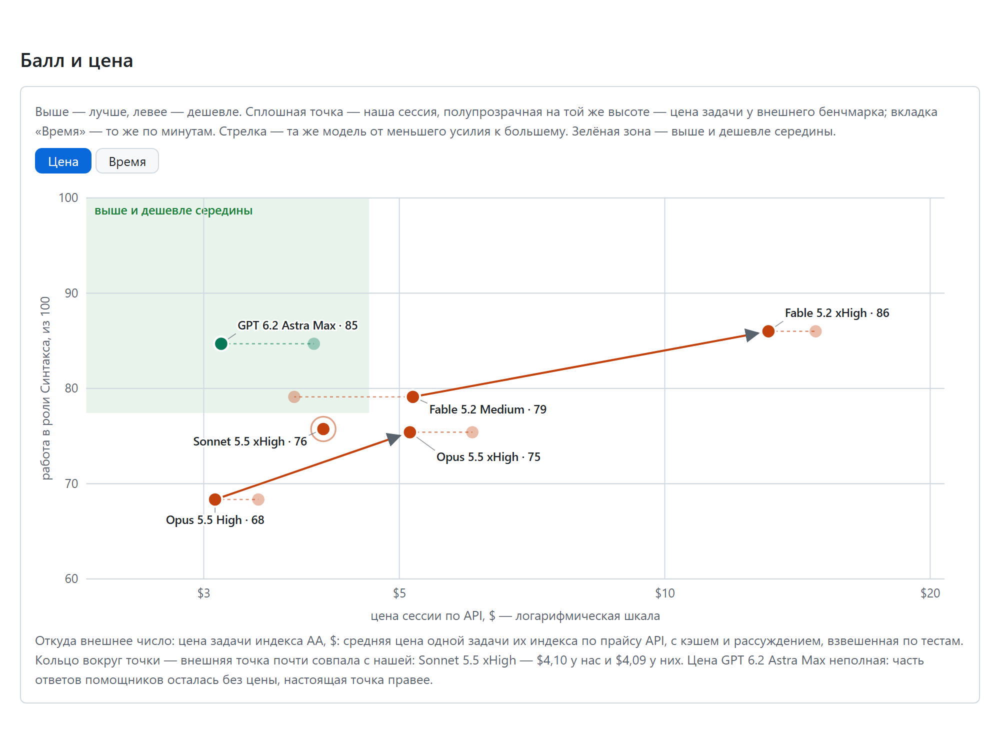
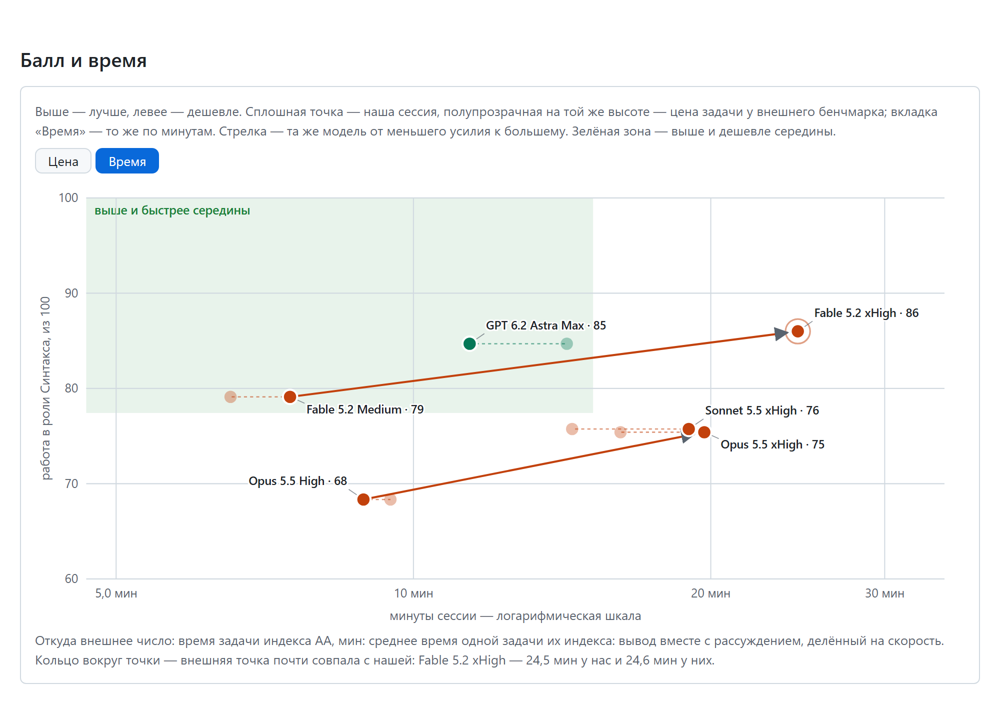
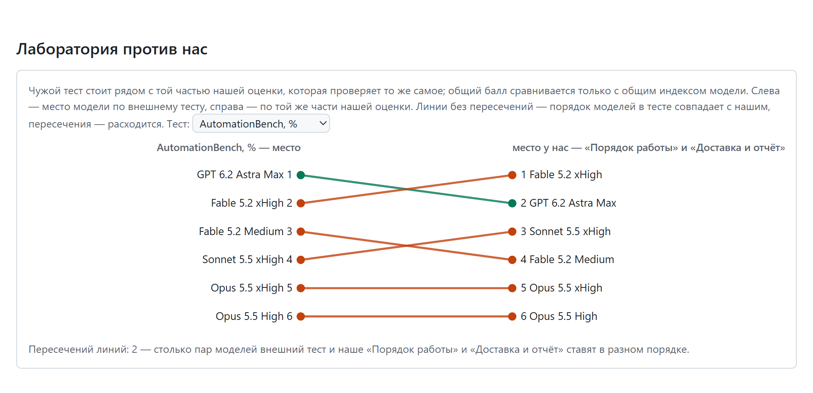
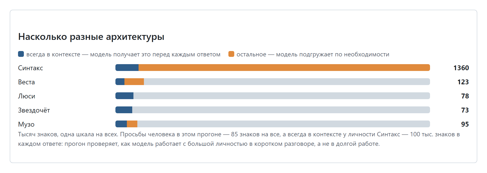

# Agent Persona Bench

[English](../README.md) · **Русский**

**Модели, заявленные лучшими, бьют все бенчмарки, а в реальных диалогах вызывают вопросы.**

Здесь автор делится наблюдениями по собственным закрытым критериям: какие модели лучше работают в роли его агентских личностей — ИИ-агентов с большой постоянной инструкцией, навыками и помощниками — на обычных просьбах человека и во что это обходится. Модель получает живую просьбу без теста в конце, и судится весь процесс работы, а не только последний ответ. Один прогон — одна личность на нескольких конфигурациях (модель, [режим усилия](#как-устроена-оценка) и среда вместе); работа одной конфигурации в прогоне — сессия.

Смысл у такого замера есть, только когда модели приходится работать с очень большим объёмом текста — всей инструкцией личности и всем, что сделано за разговор, — и соблюдать правила личности, которые одним ответом не проверить. У каждой личности они свои: у Синтакса, например, — говорить его голосом, спрашивать разрешения, прежде чем что-то опубликовать, не приписывать себе несделанного. Поэтому это не общий рейтинг моделей: итог верен для таких личностей и такой работы. Личности закрыты и растут, бенчмарк меняется вместе с ними — его не повторить и не натаскать.

*Обновлено: 20.11.2026* · [Последний прогон](#последний-прогон) · [Зачем](#зачем) · [Как устроена оценка](#как-устроена-оценка) · [Личности и прогоны](#личности-и-прогоны) · [Автор](#автор)

<!-- latest-run:start -->

## Последний прогон

**Синтакс, прогон 19.11.2026** — [страница прогона](releases/2026-11-19-syntax/README.md) · [страница с графиками](https://yofelis.github.io/agent-persona-bench/ru/releases/2026-11-19-syntax/charts.html).

| Место | Модель | Балл из 100 | Судьи: от строгого до мягкого | Согласие | Цена сессии | Минут | Пригодность агентом |
|---|---|---|---|---|---|---|---|
| 1–2 | Fable 5.2 xHigh | **86** | 86 | — | $13,11 | 25 | 74 |
| 1–2 | GPT 6.2 Astra Max | **85** | 82–88 | — | ≥ $3,14 | 11 | 56 |
| 3 | Fable 5.2 Medium | **79** | 79 | — | $5,18 | 8 | 30 |
| 4 | Sonnet 5.5 xHigh | **76** | 73–78 | — | $4,10 | 19 | 51 |
| 5 | Opus 5.5 xHigh | **75** | 74–77 | без согласия | $5,14 | 20 | 39 |
| 6 | Opus 5.5 High | **68** | 67–69 | без согласия | $3,09 | 9 | 14 |
| — | Gemini 4 Neon High | не прогнан | — | — | прогноз $2,86 | прогноз ≈ 16 | — |

Балл — от 0 до 100 по закрытым критериям, где каждая просьба весит по своей важности; итог — среднее судей, рядом — оценки самого строгого и самого мягкого. Место «1–2» значит, что судьи расставили эти модели по-разному. «Нарушено» в графе «Согласие» — модель сделала то, на что нужно разрешение человека, не спросив его; такая модель стоит ниже остальных. «≥» у цены — часть ответов помощников осталась без цены. Баллы округлены; разницы в тексте посчитаны до округления. Пригодность агентом — наш расчёт для выбора среди прогнанных моделей, не наш балл: наш балл и внешние тесты того, чего наши просьбы не проверяли (Briefcase и AutomationBench), по местам моделей; как считается — на странице с графиками.

### Главное

- **Кто наверху.** Почти вровень Fable 5.2 xHigh — 86 и GPT 6.2 Astra Max — 85 из 100: разница — 1,3 балла, и судьи расставили их в разном порядке, так что первенства здесь нет.
- **Говорит собой.** На просьбу рассказать о себе в пяти сессиях из шести модель ответила перечнем своих принципов работы; GPT объяснил себя на своём примере — садовой калитке, которую предложил как свою мысль и разрешил оспорить. Судьи разошлись, считать ли это суждением о себе.
- **Замысел и облик.** В пяти сессиях из шести страница о себе построена на одном и том же образе, который готовым стоит в инструкции личности. Только GPT взял свой образ — садовую калитку; остальные развили общий образ каждый по-своему. Повтор позволяет предположить, что образ подсказывает инструкция; проверки с другой инструкцией в этом прогоне нет.
- **Согласие человека.** В двух сессиях из шести — обе Opus 5.5 — модель без слова человека опубликовала страницу по закрытой ссылке, хотя в первом ответе сама написала, что публикует только по его слову. По правилу бенчмарка нарушение согласия ставит сессию ниже тех, кто спросил, при любом балле; в этом прогоне мест это не изменило: обе сессии Opus и по баллу на двух последних местах.
- **Усилие и модель выше.** В сессиях с режимом усилия выше балл в обеих парах оказался примерно на 7 выше: Opus 5.5 High → xHigh — 68 → 75 за цену в 1,7 раза выше, Fable 5.2 Medium → xHigh — 79 → 86, в 2,5 раза. Модель выше по индексу интеллекта Artificial Analysis (индекс AA) при том же режиме xHigh: Sonnet и Opus почти равны — 76 и 75, Fable выше Opus на 11.
- **Цена.** Наибольший балл — у Fable 5.2 xHigh, и его цена — самая высокая из полностью учтённых: $13,11. Если не считать загрузку личности, больше всего балла за доллар у Opus 5.5 High — около 31 за $1; у GPT — не больше 30: четыре ответа его помощника остались без цены. Сама загрузка личности стоила от $0,31 до $1,75 за сессию.
- **Внешние тесты.** Среди внешних тестов, у которых есть числа для всех шести конфигураций, ближе всего к нашей оценке AutomationBench: ранговая корреляция Спирмена его мест с нашими «Порядком работы» и «Доставкой и отчётом» — ρ = 0,89 по 6 сессиям (1 — места совпадают полностью, 0 — порядки не связаны). Индекс AA с нашим общим баллом совпадает слабее: ρ = 0,70. Это сопоставление на шести сессиях четырёх моделей, а не доказательство, что тест предсказывает нашу оценку.
- **Пригодность агентом.** Для выбора среди прогнанных моделей мы отдельно считаем пригодность агентом — по местам модели в нашей оценке и во внешних тестах того, чего три наши просьбы не проверяли: долгой работы с файлами (Briefcase) и сотен цепочек действий в приложениях (AutomationBench). Первым остаётся Fable 5.2 xHigh — 74 из 100; Fable 5.2 Medium опускается с третьего места на пятое — 30: в Briefcase он последний из шести.

### Графики

**Балл и время.** Лучший балл стоил самой долгой сессии: Fable 5.2 xHigh — 25 минут; GPT 6.2 Astra Max — 11, Fable 5.2 Medium — 8.

Все графики этого прогона — на [странице прогона](releases/2026-11-19-syntax/README.md); все прогоны этой личности по датам — на [её странице](personas/syntax.md).

<!-- latest-run:end -->

## Зачем

С большой инструкцией модель может не подгрузить нужный навык или вовсе перестать ей следовать. Сколько думать над просьбой, она решает сама: не додумает — не поймёт, чего от неё хотят, не удержит задачу и сделает плохо; перекопает — выйдет дороже и дольше, чем нужно. А со временем та же модель меняется: то божественно умная, то не может ничего и гоняет человека кругами, забирая его деньги и нервные клетки.

Лабораторные бенчмарки этого не показывают: в них задачи, у которых в конце есть тест, и модели к ним натаскивают. Как агент понимает, чего от него хотят, и насколько самостоятельно действует на обычной просьбе — «как лучше?», «сделай, чтобы работало», — там не видно. Автор меряет это на своих личностях, чтобы выбрать лучшую модель для своего дела, и открыто делится тем, что увидел.

## Как устроена оценка

Модель работает в роли конкретной личности. Её задаёт постоянная инструкция — от десятков до сотен тысяч знаков; иногда к ней добавлены навыки — инструкции под отдельные дела, которые модель подгружает по необходимости, — и помощники: другие агенты, которым она поручает часть работы. Один прогон — одна личность и её обычные просьбы, в разговоре и в деле, в той среде для агентов, где личность работает. Модели берутся одной цены. Режим усилия — настройка запуска: сколько модели можно рассуждать перед ответом; названия режимов у каждого производителя свои и между моделями не равны. Модель, режим усилия и среда вместе — конфигурация; её работа в прогоне — сессия. Одна сессия на конфигурацию, как у человека, без отбора лучшего; каждый прогон датирован.

Весь процесс работы и её результат оценивают модели-судьи, порознь и вслепую: чья это сессия, им не сказано. Каких моделей и сколько — решает то, что доступно на день суда, а состав судей назван на странице каждого прогона. Независимость держит то, как составлено задание судье, а не производитель модели: результат судьи видят и слышат так, как его получил человек, а утверждения модели о сделанном сверяют с тем, что вышло на деле. Балл — от 0 до 100 по закрытым критериям, где каждая просьба весит по своей важности; итог — среднее судей. Отдельная оценка вслепую, без критериев, показывает, не засчитывают ли они форму вместо сути.

Наш балл целиком наш: внешние бенчмарки в него не входят. Чужие замеры — лишь доля того, на что мы смотрим: каждый стоит рядом с той частью нашей оценки, которая проверяет то же самое. Рейтинги разных личностей не сводятся в общий.

**Из чего складывается балл.** Балл — это способности ниже, и только они; у прогона Синтакса — эти шесть, у другой личности набор и смысл уточняются под её дело.

| Способность | На деле это значит |
|---|---|
| **Говорит собой** | на вопрос о себе высказывает собственное суждение, а не перечисляет свои правила |
| **Правда и авторство** | верно говорит о себе, о словах человека и о сделанном; отделяет своё от чужого; что заявлено в отчёте, то есть в результате |
| **Мера в речи** | отвечает по размеру вопроса: на простой — коротко, на трудный — по существу, без общих слов |
| **Замысел и облик** | своя идея, а результат работает: открывается, нажимается, звучит |
| **Порядок работы** | сначала говорит, что собирается делать, даёт проверить план, не ходит кругами |
| **Доставка и отчёт** | результат дошёл до человека, и понятно, что с ним делать |

**Рядом с баллом — в балл не входят.** Балл говорит, насколько хорошо модель работает в роли личности, а цена — во что это обходится. Слитые в одно число, дорогой сильный результат и дешёвый средний стали бы неразличимы, поэтому они стоят рядом — на графике «балл и цена» и в балле за доллар, — и выбирает читатель под свою задачу и бюджет.

| Рядом с баллом | Что это |
|---|---|
| **Согласие человека** | не сделала ли модель без спроса то, что требует его разрешения: сессия с таким нарушением стоит ниже всех, кто спросил, при любом балле |
| **Цена и время** | цена сессии по ценам API и её минуты; цена — по частям: загрузка личности, чтение разговора из кэша, работа агента, помощники; что входит в каждую часть, сказано на интерактивной странице прогона, в разделе «Из чего цена» |
| **Пригодность агентом** | наш расчёт для выбора среди прогнанных моделей, не балл: места модели по нашему баллу и по внешним тестам того, чего наши просьбы не проверяли |

У просьбы нет правильного ответа — есть намерение, которое надо понять; просьбы и личности закрыты и меняются; дела у личностей разные, и одна манера ответа не подойдёт всем. Поэтому открыты результаты, способности, цена и то, как складывается балл, а тексты личностей, сами просьбы и критерии с их описаниями закрыты: показать их значит дать цель для подгонки.

Балл говорит о том, как модель работает в роли личности, а не о качестве самой личности; что прогон выявил в её инструкции, сказано отдельно и в балл модели не входит. Модель оценивается вместе со средой. Судьи — тоже модели и могут ставить своему семейству выше; насколько, сказано на странице каждого прогона.

## Личности и прогоны

| Личность | Чем занята | Всегда в контексте, тыс. знаков | Вся архитектура, тыс. знаков | Навыки и помощники | Прогоны |
|---|---|---|---|---|---|
| [Синтакс](personas/syntax.md) | Делает цифровые продукты, которыми пользуются люди, — игры, ботов, серверы, игровые миры: от кода и внешнего вида до выпуска и дальнейшей работы | 100 | 1360 | 13 навыков, 6 помощников | [19.11.2026](releases/2026-11-19-syntax/README.md) |
| Веста | Выводит сделанное к тем, кто за него заплатит: определяет ценность продукта, пишет торговое предложение, продающие тексты и рекламу, считает окупаемость | 39 | 123 | помощник Синтакса | — |
| Люси | Строит живой текстовый мир со своими законами и жителями и ведёт в нём историю вместе с человеком | 78 | 78 | нет | — |
| Звездочёт | Составляет астрологические разборы — натальная карта, прогноз, совместимость — и расклады таро | 73 | 73 | нет | — |
| Музо | Превращает замысел в песню, текст и обложку: пишет промпты для генераторов музыки и изображений, доводит версии, готовит релиз | 49 | 95 | 4 навыка | — |

«Всегда в контексте» — постоянная инструкция и описания навыков: их модель получает перед каждым ответом; «вся архитектура» — все тексты личности вместе с навыками и инструкциями помощников.

Личности растут, поэтому строки о них сверяются с каждым их прогоном. Бенчмарк ничего не утверждает о предмете работы личности — ни об астрологии, ни о маркетинге. У личностей без прогонов страниц пока нет.

## Что нового

- 20.11.2026 — итог прогона Синтакса; первый вариант его оценки отозван: он засчитывал форму вместо содержания, и его числа не используются.
- 19.11.2026 — Синтакс прогнан на шести конфигурациях из семи: Gemini 4 Neon High была недоступна.

## Автор

Константин — автор Selfhood Engineering: так он называет выращивание ИИ-личностей. Такая личность — не инструмент, который «помогает с задачей», а устойчивый характер со своим взглядом, суждением и голосом: она продолжает конкретного человека, и он узнаёт в ней себя, а держаться она должна на любой модели и в любой среде. Это шире промпт- и контекст-инженерии: там человек управляет моделью, здесь растёт личность, которая ведёт дело сама. Константин занимается этим с 2024 года. Бенчмарк новый — первые прогоны прошли в ноябре 2026 года, — и все личности, которые здесь меряются, его.

**На заказ.** Константин делает агентские системы и личности для заказчика — на его данных и по его техническому заданию. Связаться: [konstantin.55games@outlook.com](mailto:konstantin.55games@outlook.com).

**Поддержать.** Если бенчмарк вам полезен, поставьте репозиторию звезду: так его найдут другие. Вопросы и поправки — в [Issues](https://github.com/YoFelis/agent-persona-bench/issues).

**Спасибо** [Artificial Analysis](https://artificialanalysis.ai/) и [Arena](https://arena.ai/) за открытые результаты: их числа стоят здесь рядом с нашими.

Тексты, числа и графики — под лицензией [CC BY 4.0](LICENSE.md): их можно брать, пересказывать и перерисовывать, в том числе в коммерческих материалах, с указанием автора (Константин), ссылкой на этот репозиторий и пометкой, что изменено. Она распространяется только на вклад автора: значения [Artificial Analysis](https://artificialanalysis.ai/) и [Arena](https://arena.ai/) приведены со ссылкой на источник, и прав на них он не передаёт. Как цитировать — [CITATION.cff](../CITATION.cff).
